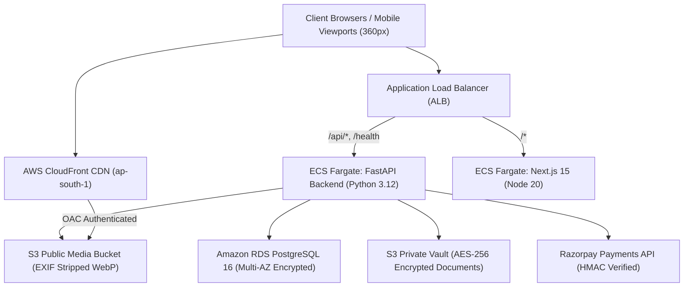

# ListedWheels Operations & Maintenance Runbook

Welcome to the **ListedWheels** operational runbook. This document guides Site Reliability Engineers (SREs), system administrators, and compliance officers in managing, deploying, and troubleshooting the platform.

---

## 1. System Topology & Architecture



### Key Components:
- **Region**: `ap-south-1` (Mumbai, India).
- **Backend API**: FastAPI on Python 3.12 (`/api/v1/`), port 8000.
- **Frontend Web App**: Next.js 15 App Router on Node 20, port 3000.
- **Database**: PostgreSQL 16 with SQLAlchemy 2.0 Async + Alembic.
- **Media**: Dual S3 buckets (Public WebP CDN + Private Document Vault with 900s signed URLs).

---

## 2. Zero-Downtime Deployment & Alembic Migrations

### Deployment Checklist:
1. **Run Backend Test Suite**:
   ```bash
   cd backend
   pytest tests/unit/ -v
   ```
2. **Build Frontend Bundle**:
   ```bash
   cd frontend
   npm run build
   ```
3. **Execute Database Migrations** (Run from deployment task container):
   ```bash
   cd backend
   alembic upgrade head
   ```
4. **ECS Service Rolling Update**:
   ```bash
   aws ecs update-service --cluster listedwheels-cluster-production \
                          --service listedwheels-backend-service \
                          --force-new-deployment
   ```

---

## 3. Database Management & Backups

### Automated Daily Snapshots:
- RDS automated backup window: `21:00-22:00 UTC` (`02:30-03:30 IST`).
- 7-day retention period with Point-In-Time Recovery (PITR).

### Manual Backup:
```bash
./scripts/backup_db.sh
```

### Database Restore Procedure:
1. Download the target dump file from the S3 backup vault.
2. Execute the restore script:
   ```bash
   ./scripts/restore_db.sh /path/to/backup_file.sql.gz
   ```

---

## 4. GSTR-1 Tax Filing & Reconciliation

At the end of each calendar month, generate the GSTR-1 CSV invoice export:

```bash
python scripts/gstr1_export.py --year 2026 --month 10 --out exports/GSTR1_2026_10.csv
```

### Verification Rules:
- **Intra-state (Tamil Nadu)**: Invoices reflect **CGST 9% + SGST 9%**.
- **Inter-state (Rest of India)**: Invoices reflect **IGST 18%**.
- All invoices must have sequential numbers format: `INV-YYYYMM-XXXX`.

---

## 5. Trust, Safety & Ban Enforcement

### 1-Active-Listing Rule:
- Vehicle registration numbers for Cars and Bikes are normalized and hashed with SHA-256 (`reg_no_hash`).
- A partial unique index prevents duplicate live listings for the same registration.

### Fraud Ban Execution:
When an admin bans a user via the Admin Portal (`/admin`):
1. User status is set to `banned`.
2. Existing active listings are transitioned to `removed`.
3. The user's SHA-256 hashed phone number, registration hashes, and document hashes are saved to the `bans` table.
4. Any future login or listing attempt matching banned hashes is blocked with HTTP 403 Forbidden.

---

## 6. Incident Response Runbooks

### Incident 1: Razorpay Webhook Delivery Failure
- **Symptom**: User completes payment on Razorpay modal, but listing status stays `pending_payment`.
- **Resolution**:
  1. Check Razorpay Dashboard -> Webhooks log for HTTP 500 or timeout responses.
  2. In ListedWheels Admin Portal, inspect the `orders` table using the Razorpay payment ID.
  3. Replay the webhook event from Razorpay Dashboard (the backend webhook handler is fully idempotent and keyed on `razorpay_payment_id`).

### Incident 2: High Latency / Database Connection Exhaustion
- **Symptom**: API response time header `X-Process-Time-Ms` exceeds 500ms.
- **Resolution**:
  1. Check RDS CloudWatch CPU & DatabaseConnections metrics.
  2. Verify that async sessions in FastAPI dependencies are properly closing with context managers.
  3. If traffic spike, scale ECS backend tasks:
     ```bash
     aws ecs update-service --cluster listedwheels-cluster-production \
                            --service listedwheels-backend-service \
                            --desired-count 4
     ```

### Incident 3: S3 Media Access 403 Errors
- **Symptom**: CloudFront image requests fail with 403 Forbidden.
- **Resolution**:
  1. Verify CloudFront Origin Access Control (OAC) configuration in `s3_cloudfront.tf`.
  2. Confirm S3 public bucket policy permits `s3:GetObject` with condition matching CloudFront Distribution ARN.
